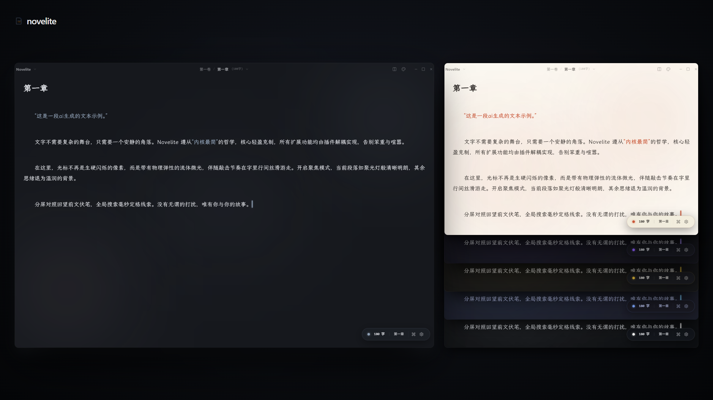
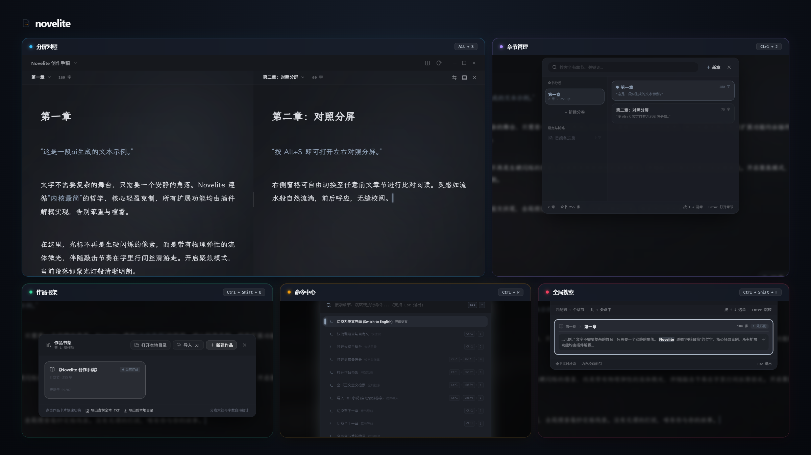
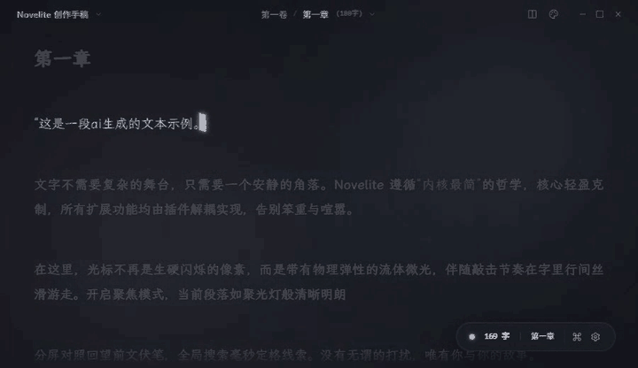

<div align="center">


# Novelite

**轻量内核 · 极简外观 · 插件化架构的现代小说文本编辑器**

[](./LICENSE)
[](https://github.com/hirovel/novelite/releases)

[简体中文](./README.md) · [English](./README_EN.md)

<br />



</div>

---

为了自己写小说的体验，制作了 Novelite，希望简洁的外观和丝滑的光标能带来愉悦的编辑体验。

根据**内核最简**的原则设计，核心保持轻量，扩展功能均由插件解耦实现。

### 目前已经实现的功能



<br />

- **流体光标**
  
  

- **聚焦模式**：高亮编辑段落，暗淡其他
- **微光背景**
- **分屏对照**
- **快捷搜索词汇**
- **章节管理**
- **快捷键设置，命令中心**

---

### 安装和运行

提供 **Windows x64** 和 **Apple Silicon Mac（M 系列）** 独立桌面应用。安装后从开始菜单或「应用程序」打开，无需 Node.js。

#### Windows：一行安装

在 PowerShell 中运行（无需管理员终端）：

```powershell
irm https://raw.githubusercontent.com/hirovel/novelite/main/install.ps1 | iex
```

脚本下载最新桌面安装器、校验 SHA-256 并静默安装。安装失败会报错，完成后从开始菜单打开 Novelite。更新时重新运行同一命令。
也可从 [Releases](https://github.com/hirovel/novelite/releases/latest) 下载 `*-setup.exe` 或 `.msi`。需要 Windows 10/11 x64；安装器会按需安装 Microsoft Edge WebView2 运行时。

#### Mac：Homebrew 安装

已安装 [Homebrew](https://brew.sh) 的用户，在终端运行：

```bash
brew tap hirovel/novelite https://github.com/hirovel/novelite.git && brew install --cask hirovel/novelite/novelite
```

安装后从「应用程序」打开 Novelite。更新和卸载：

```bash
brew update && brew upgrade --cask --greedy hirovel/novelite/novelite
brew uninstall --cask hirovel/novelite/novelite
```

卸载应用保留手稿和设置。Homebrew 校验安装包的 SHA-256；安装源随正式发布自动更新。
也可直接下载 [DMG](https://github.com/hirovel/novelite/releases/latest)，拖入「应用程序」。需要 macOS 11+ 和 Safari/WebKit 16.4+；Homebrew 自身的系统要求以其官网为准。

当前 Mac 版为 ad-hoc 签名，未经 Apple 公证。首次启动如被拦截，在「系统设置 → 隐私与安全性」选择「仍要打开」。参见 [Apple 说明](https://support.apple.com/102445)。

支持原生文件夹读写和保存对话框。Mac 快捷键使用 `⌘`，重做为 `⌘⇧Z`，替换为 `⌘⌥F`。
重启后需重新选择本地文件夹来恢复磁盘连接；已编辑的手稿仍保留在应用内。

#### 自动更新

从 v1.0.3 起，应用启动后及每 4 小时自动检查更新，也可在命令中心选择「检查软件新版本」。点击「安装并重启」后，会下载并校验更新签名、保存手稿，再安装并重启；保存或校验失败时不会继续安装。离线检查失败会明确提示，可稍后重试。

v1.0.2 及更早版本请先用上述安装命令或安装包升级一次。之后可直接在应用内更新。Homebrew 用户也可使用上述 `--greedy` 更新命令。升级保留手稿和设置；重启后重新选择本地文件夹以恢复磁盘同步。

#### 开发桌面应用

需要 Node.js 22.12+（CI 使用 24）、Rust 和 [Tauri 系统依赖](https://v2.tauri.app/start/prerequisites/)。

```bash
git clone https://github.com/hirovel/novelite.git
cd novelite
npm ci
npm run dev
```

`npm run dev` 打开独立桌面窗口。`npm run tauri:build` 生成当前平台安装包。npm 只用于开发工具链；不发布 npm 启动器。
发布步骤见 [发布指南](./docs/RELEASING.md)。

---

### 协议与版权

GNU General Public License v3.0 (GPL-3.0)
