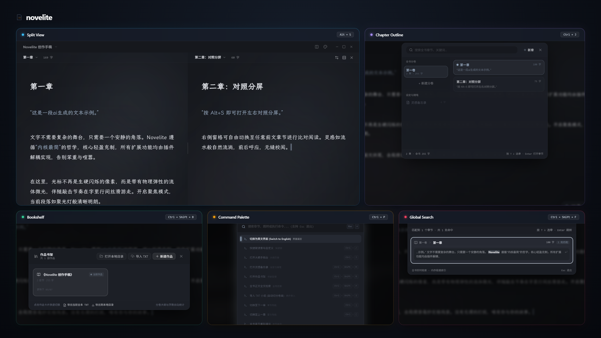

<div align="center">


# Novelite

**A minimal desktop novel editor with lightweight core, clean aesthetics, and plugin-driven architecture.**

[](./LICENSE)
[](https://github.com/hirovel/novelite/releases)

[简体中文](./README.md) · [English](./README_EN.md)

<br />


</div>

---

Crafted to enhance personal novel writing, Novelite pairs a clean visual aesthetic with a buttery-smooth cursor for an enjoyable writing experience.

Designed with a **minimal core** principle, the foundation remains lightweight while extended features are decoupled via plugins.

### Currently Implemented Features



<br />

- **Fluid Cursor**
  
  

- **Focus Mode**: Highlights active paragraph, dims others
- **Ambient Background**
- **Split View Reference**
- **Quick Vocabulary Search**
- **Chapter Management**
- **Keymap Settings & Command Center**

---

### Installation & Run

#### Windows Desktop Client

Download `*-setup.exe` or `.msi` from [Releases](https://github.com/hirovel/novelite/releases/latest).

#### macOS Desktop App

Requires macOS 11 or later with Safari/WebKit 16.4+ (install Safari updates on older systems). Download `*_aarch64.dmg` for Apple Silicon (M-series), or `*_x64.dmg` for Intel, from [Releases](https://github.com/hirovel/novelite/releases/latest). Open the DMG and drag Novelite into Applications.

This version is ad-hoc signed and **not notarized by Apple**. If the first launch is blocked, use **System Settings → Privacy & Security → Open Anyway**. See [Apple's guidance](https://support.apple.com/102445).

Native folder access and save dialogs are supported. Shortcuts use `⌘`; redo is `⌘⇧Z` and replace is `⌘⌥F`. After relaunch, reselect the local folder to restore disk sync. Your local manuscript copy remains in the app.

#### Linux Desktop App

Download `.deb` or `.AppImage` from [Releases](https://github.com/hirovel/novelite/releases/latest).

#### Run from Source

```bash
git clone https://github.com/hirovel/novelite.git
cd novelite
npm ci
npm run dev
```

Requires Node.js 22.12+ (CI uses Node.js 24). Desktop development also needs Rust and the [Tauri prerequisites](https://v2.tauri.app/start/prerequisites/); run `npm run tauri:dev` to start it.

See the [release guide](./docs/RELEASING.md) for development checks and publishing.

---

### License & Copyright

GNU General Public License v3.0 (GPL-3.0)
